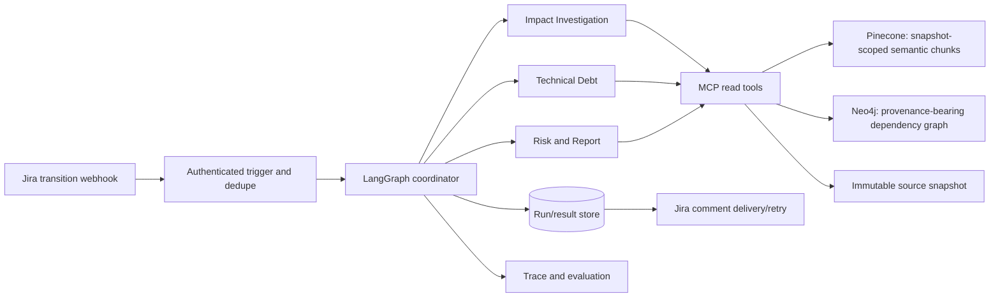

# Agent architecture and implementation

## Purpose and boundary

The assessment system reads a Jira requirement and a pinned application snapshot. It returns a sourced change-impact report, risks, tests, debt candidates, and open questions. It never writes to the six commerce repositories. The only writes are the versioned evidence index, assessment artifacts, and an optional Jira comment.

This workspace now contains a runnable, dependency-free local vertical slice in `impact_assessment/`. It builds a content-addressed evidence snapshot, extracts dependency edges from the checked-in service configs, runs the three specialist stages, checks evidence IDs against that snapshot, and persists `assessment.json`, `report.md`, and `trace.ndjson`. Optional LangGraph orchestration and a read-only MCP server can run over that local snapshot. Jira webhook and comment-delivery code is implemented but needs credentials and HTTPS ingress. Reasoning is deterministic retrieval and policy code; Pinecone, Neo4j, language-model reasoning, and Langfuse are not configured.

## Target architecture



Jira delivery is outside the agent graph. A webhook transition starts a run keyed by `(issue key, issue version, evidence snapshot)`. A duplicate webhook reuses the existing result. The report is persisted before delivery; comment failures record a delivery status and can be retried with the saved run ID without rerunning analysis.

### Coordinator and typed state

The LangGraph state is a versioned `RunContext`, normalized `Requirement`, immutable investigation revisions, debt result, verification requests, retry counter, and final assessment. Nodes are `normalize_ticket`, `investigate`, `assess_debt`, `verify_and_report`, and `persist`. The report reviewer can route specific evidence gaps back to investigation up to two times. If revised findings change affected components, the coordinator invalidates and recomputes only overlapping debt decisions. Tool calls, retrieval results, graph paths, errors, and routing are trace events. The graph does not receive write access to Pinecone/Neo4j.

### Three specialist agents

| Agent | Reads | Produces | Guardrail |
|---|---|---|---|
| Impact Investigation | Ticket, docs/source search, exact identifiers, contracts, graph paths | Requirement fields, repository impacts, source evidence, paths, questions | No impact claim without resolvable evidence; semantic similarity alone is a lead |
| Technical Debt | Impact components, debt items, source/test refs, graph relationships | `recommend`, `do_not_recommend`, or `needs_clarification` per stable debt ID | Open item, direct overlap, documented estimate including tests at or under 3 hours, and a shared test are all required |
| Risk and Report | Both agent artifacts and original evidence | Targeted verification requests or final status/report | Validate snapshot and references; reject or qualify unsupported claims; severity is separate from certainty |

The local implementation follows these same boundaries in `impact_assessment/agents.py`; agent outputs are structured values rather than passing summary prose from one agent to another. `impact_assessment/langgraph_coordinator.py` wires the same agents as graph nodes when the optional runtime is installed.

## Evidence and snapshot pipeline

1. Record each repository's immutable commit and a hash per indexed file. The snapshot ID covers both. Never mix evidence across snapshots.
2. Read implementation-reviewed Markdown, OpenAPI, contracts, local/development config, source, and relevant tests. Preserve repository-relative path, section, line range, source commit, document type, extraction method, and stable evidence ID.
3. Parse debt documents as separate stable items using repository + debt ID. Validate status, components, implementation/testing estimates, estimate basis, and test references. Missing or provisional effort remains unknown for eligibility; it is never converted to zero.
4. Create Pinecone chunks by meaningful doc section or one debt item. Every vector carries snapshot, commit, repository, path, section, source refs, document type, and debt metadata. Searches always filter by snapshot and type.
5. Build Neo4j nodes for repositories, files, symbols, APIs, events, fields, persistence, and debt items. Edges such as `CALLS`, `PUBLISHES`, `CONSUMES`, `MAPS_TO`, `READS`, and `WRITES` cite their source lines and record `explicit`, `inferred`, or `ambiguous` classification. Derive runtime service edges first from the six configs and enrich them with handlers/mappings; do not invent edges to connect the graph.
6. Validate counts, duplicate IDs, source references, snapshot agreement, and known paths before publishing an index version. Keep old snapshots addressable for prior reports.

The local prototype stores this data under ignored `.impact_assessment/snapshots/`. Its lexical search is clearly a fallback; it does not produce embeddings. Its local graph currently extracts configured HTTP and message topic edges, not complete symbol/field/table relationships.

## MCP read interface

Expose bounded, read-only tools with an explicit `snapshot_id` parameter:

```text
search_docs(query, repositories?, limit?)
search_technical_debt(query, repositories?, limit?)
search_identifiers(query, repositories?, limit?)
traverse_dependencies(start_ids, relationships?, direction, max_hops, limit)
fetch_evidence(evidence_ids)
get_contract(component_id)
```

Every result includes provenance, empty/error state, and snapshot ID. Validate relationship names, constrain hops/results/timeouts, and avoid arbitrary Cypher or Pinecone filter expressions from the model. Source fetch accepts only IDs returned by the selected snapshot. Agents have no index-write tool.

The `impact_assessment/mcp_server.py` adapter wraps `LocalEvidenceStore` with bounded read-only MCP tools. It uses one pinned snapshot per server process and rejects mismatched snapshot IDs. Production adapters route the same operations to the selected Pinecone namespace/index and Neo4j database.

## Workflow and status rules

```text
normalize ticket
  -> retrieve docs + exact matches + graph paths
  -> investigate only evidence-supported candidate components
  -> retrieve and inspect debt items in those components
  -> verify all claims, paths, IDs, snapshot, and cited source refs
       -> specific gap + retry available: targeted reinvestigation
       -> complete evidence: complete or needs_clarification
       -> unavailable/budget exhausted: partial with limits
  -> persist result and trace
  -> deliver Jira comment asynchronously/retryably
```

`no_impact_found` means none in the searched scope; it is not proof of absence. A graph path must cite evidence for every edge. A severe risk may still have weak support. Questions should name the specific product decision and why it changes implementation. Unknown or provisional debt estimates block recommendation.

## Jira integration

Configure a dedicated transition (for example, `Ready for Impact Analysis`) and webhook secret/token outside the repository. Validate the webhook before reading ticket data. Fetch the current issue from Jira instead of trusting a partial webhook body. Normalize rich-text descriptions and acceptance criteria; retain issue `updated` or changelog version. Filter out agent-generated comment events and other transitions. Deduplicate by issue, version, and snapshot. Persist first; post a concise report with evidence refs and the run ID. Keep Jira API failures in a delivery queue so they do not rerun agent reasoning.

The adapter in `impact_assessment/integrations/jira.py` accepts either Jira's HMAC `X-Hub-Signature` or a configured custom token header, fetches the current issue, uses the issue `updated` value as its version, deduplicates the assessment and comment, and separates delivery retry from reasoning. It listens on loopback by default; hosted deployment must put it behind HTTPS ingress. Configure the Jira REST user for issue read and comment read/create. Local replay uses normalized ticket JSON and needs no Jira credentials.

## Trace and privacy

Each trace event records run, agent, tool, timestamp, sanitized search parameters, evidence IDs, outcome/error, and duration. It must not record credentials, payment data, raw request bodies, private model reasoning, or full sensitive Jira descriptions. Model observations should record provider/model name and token usage when available. Subagent runs should appear as distinct agent nodes rather than duplicate dispatch and execution nodes. The local implementation records inspectable JSONL traces, but no Langfuse connection is configured.

## Runtime and evaluation

Use local replay as the deterministic baseline. For hosted operation, pin compatible versions of LangGraph, the Pinecone SDK, Neo4j driver, MCP SDK, model SDK, and tracing SDK in a lockfile; pass credentials through secret storage, never checked-in config. Deploy behind authenticated Jira webhook ingress. Replit is a deployment target to validate after storage, worker, and outbound network behavior are confirmed.

Keep the eight benchmark expected outputs outside retrieval/indexed content. Score repository precision/recall, evidence-reference validity, correct edge/path support, question quality, debt gates, duplicate delivery, runtime, and tool errors. Review human-labeled expected impacts before treating a score as a release gate. The local CLI is the replay entry point; hosted evaluation should preserve the same snapshot and contracts.

## Implemented now and next

Implemented now:

- Versioned typed artifacts in `impact_assessment/models.py`.
- Content-addressed local snapshot, evidence search, exact identifier search, configured HTTP/MQ edge extraction, and debt parsing in `impact_assessment/store.py`.
- Three bounded specialist stages, evidence reference verification, effort gate, risk/questions, and JSONL trace in `impact_assessment/agents.py`.
- Local coordinator and durable report persistence in `impact_assessment/workflow.py`.
- Optional LangGraph node orchestration in `impact_assessment/langgraph_coordinator.py` and read-only MCP tools in `impact_assessment/mcp_server.py`.
- Authenticated Jira transition intake, issue-version/snapshot deduplication, saved report comments, and retryable delivery in `impact_assessment/integrations/jira.py`.
- Replay CLI in `impact_assessment/cli.py`.

Next integrations, in order:

1. Add Pydantic validation at persisted/agent boundaries and bounded verification-request routing in LangGraph.
2. Implement snapshot writers/readers for Pinecone and Neo4j behind the existing store operations; run graph extraction and reconciliation against source configs/contracts.
3. Connect agents as MCP clients to the selected snapshot backend; test pinning and query filters.
4. Add model-backed structured requirement normalization and verification, with the same evidence and eligibility gates.
5. Add a run lookup UI and configure the Jira transition, webhook, credentials, and HTTPS ingress.
6. Run the eight-ticket benchmark, resolve unsupported findings, verify the live ActiveMQ/provider flow separately, then validate Replit.
