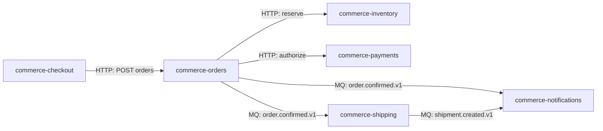
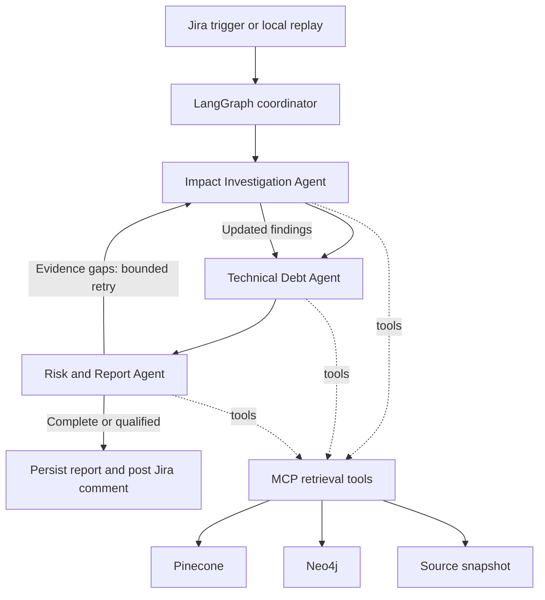

# E-commerce repository impact assessment: overall plan

## Purpose and outcome

Build a Python system that autonomously assesses a Jira requirement across six related e-commerce repositories. It uses retrieval-augmented generation (RAG), a Neo4j dependency graph, and three collaborating agents to explain where changes are likely needed and why. It also recommends small technical-debt improvements when they overlap with the requested change and can reuse testing.

The system returns a report; it does not implement changes. Autonomy means that no human approval is required between receiving the trigger and producing the assessment. Insufficient information produces explicit questions and a qualified report rather than invented dependencies.

Completion target: November 6–7, 2026. Demo day: November 10, 2026.

## Agreed scope

- E-commerce sample application with six small, related repositories generated with Codex.
- Python, LangChain/LangGraph, Pinecone semantic retrieval, and Neo4j graph traversal.
- Generated documentation under each repository's `docs/` directory, with references back to code.
- Multiple repository-local technical-debt Markdown documents under `docs/technical-debt/`; no backlog-ticket mining.
- Three agents: Impact Investigation, Technical Debt, and Risk and Report.
- Visible trace of tool calls, retrieved evidence, searches, dependency paths, routing, and results.
- Jira-triggered autonomous assessment and a local replay option for development/demo continuity.
- Replit as the intended deployment target, subject to an early connectivity and runtime check.

## Planning defaults to confirm

These defaults make implementation concrete but were not all separately confirmed:

- Technical-debt eligibility: at most three person-hours per item, including implementation and testing. Two hours or less is preferred. Unknown effort cannot qualify automatically.
- SQLite per state-owning service, a local RabbitMQ broker, FastAPI APIs, and stubbed external payment/carrier providers.
- A dedicated Jira status such as `Ready for Impact Analysis`; exact status depends on site configuration.
- Automatically post the report as a Jira comment and store the run result separately.
- Database writes refer to controlled indexing of Pinecone/Neo4j and persistence of assessment results. Agents do not modify application business databases.
- MCP exposes retrieval tools; LangGraph provides agent coordination. A2A is deferred unless the course explicitly requires it.
- LLM provider, embedding model, hosting tier, credentials, and named teammate assignments remain open.

## Six application repositories

| Repository | Minimum behavior | Data and contracts | Dependencies |
|---|---|---|---|
| `commerce-checkout` | Accept a cart and delivery details; submit an order | Checkout request and mapping to order request | Calls orders over HTTP |
| `commerce-orders` | Create an order, reserve stock, authorize payment, publish confirmation | SQLite orders/order lines/delivery details; order API; `order.confirmed.v1` | Calls inventory and payments; publishes to shipping and notifications |
| `commerce-inventory` | Reserve stock and reject insufficient inventory | SQLite stock and reservations; reservation API | Called by orders |
| `commerce-payments` | Authorize a payment through a deterministic stub | SQLite authorization records; payment API; provider mapping | Called by orders |
| `commerce-shipping` | Consume confirmed orders and create a shipment with a carrier stub | SQLite shipments; carrier mapping; `shipment.created.v1` | Consumes order event; publishes shipment event |
| `commerce-notifications` | Consume order/shipment events and render messages to a local outbox | SQLite notification outbox; templates and consumer schemas | Consumes order and shipment events |

These are six analysis targets. This workspace hosts the AI system and integration configuration separately; it is not a seventh business service. For initial scaffolding, sibling/local directories can be used, but the demo should identify each target with its own repository name and commit.



Keep the application deliberately small: one successful flow, a stock rejection, a payment rejection, and consumer deduplication. Full storefront UI, refunds, tax engines, real transactions, and production operations are outside the baseline.

## Documentation and technical-debt layout

Each application repository should contain:

```text
src/
tests/
docs/
  overview.md
  api-contracts.md
  events.md
  field-mappings.md
  data-model.md
  dependencies.md
  technical-debt/
    address-mapping.md
    event-validation.md
    other-enhancements.md
README.md
```

Generate docs from the implemented code and contracts, then inspect a sample manually. Each document records repository, source commit, generation timestamp, and source files/symbols. Do not generate fictional dependencies just to make the graph connected. Explicit configuration and schema files should establish HTTP routes, topics, publishers, and consumers.

Each repository can have multiple technical-debt documents under `docs/technical-debt/`, including nested folders. Documents may be organized by component, concern, or enhancement, and each document can contain one or more debt items. The filenames above are illustrative; each repository uses names relevant to its own components. An existing root-level `TECH_DEBT.md` is also supported as an optional legacy location, not a required single source.

Every debt item needs a stable ID unique within its repository, affected components, description, proposed change, implementation/testing effort, relevant tests, status, and estimate basis. IDs must remain stable when items move between documents. The Technical Debt Agent plan defines the item template; apply it across all discovered debt documents. The effort threshold applies per item, not per document.

## Indexing and RAG pipeline

### Preparation and refresh

Indexing runs separately from ticket assessment and consumes all six repositories. Each repository can contribute multiple general documents and multiple technical-debt documents; there is no one-document-per-repository limit.

1. **Select a snapshot.** Record repository names and immutable commit IDs in a shared manifest. Record the documentation generation version and embedding model as part of the indexing version.
2. **Prepare documentation.** Generate or refresh application docs under `docs/` from code and contracts, preserving source references. Preserve authored technical-debt documents; documentation generation must not overwrite their estimates or status.
3. **Discover documents.** Recursively scan `docs/**/*.md`. Classify `docs/technical-debt/**/*.md` as technical debt and other Markdown files as general documentation. Also include an optional root `TECH_DEBT.md`. Process each file once, even though debt files are inside `docs/`.
4. **Parse and validate debt items.** A document can contain multiple items. Extract each item's stable ID, status, components, proposed change, implementation/testing estimates, estimate basis, relevant tests, document path, and section. IDs must be unique within a repository. Flag duplicate IDs and malformed items; retain actionable validation errors rather than silently recommending them.
5. **Create retrieval chunks.** Chunk general docs by meaningful sections. Chunk debt by item, retaining its metadata with every chunk if a long item must be split. Use repository plus debt ID as the logical item identity, independent of document location. Preserve file/section provenance for citations.
6. **Write Pinecone records.** Embed and upsert chunks with deterministic record IDs for the snapshot. Use document-type metadata to distinguish general documentation from technical debt. Repeated indexing of the same snapshot must not create duplicates.
7. **Write Neo4j records.** Extract repositories, documents, endpoints, symbols, fields, tables, events, mappings, and technical-debt items. Link each debt item to its source document and supported affected components. Record evidence and classify relationships as explicit, inferred, or ambiguous.
8. **Validate and publish.** Check discovered/indexed document and item counts, duplicate IDs, source references, dangling graph links, and a known cross-repository path. Publish the snapshot only when both stores match the manifest and required validation passes. Quarantine malformed debt items and report their omission; they must not become eligible recommendations.
9. **Refresh safely.** For a new snapshot, reflect added, changed, moved, deleted, and closed debt items. Preserve logical identity when an item moves documents. Switch assessment to the new snapshot only after validation; retain previous snapshots for existing runs and remove them through a separate retention policy.

### Pinecone metadata and retrieval

Every chunk carries repository, commit, snapshot ID, indexing version, document type, document path, section, source references, and chunk ID. Debt chunks also carry debt ID, status, estimate availability, and numeric implementation/testing/total hours when known. Never encode an unknown estimate as zero.

Filter every search to the run's snapshot. The Impact Investigation Agent searches general documentation for relevant business behavior and components. The Technical Debt Agent searches across all indexed debt documents, initially prioritizing affected repositories and components. It can expand to other repositories when dependency evidence supports doing so.

Group retrieved debt chunks by repository plus debt ID, then fetch the full original item before assessing eligibility. A document containing several items produces separate candidate decisions. Semantic similarity discovers candidates; verified component overlap, effort, status, and shared tests determine recommendations. The effort limit applies per item, not per file.

### Neo4j graph and evidence

Dependency relationships include `CALLS`, `PUBLISHES`, `CONSUMES`, `MAPS_TO`, `READS`, `WRITES`, and `LOCATED_IN`. Document/debt relationships include `DOCUMENTED_IN` and `AFFECTS_COMPONENT`. Each relationship retains source references and snapshot identity. A debt item's declared component link describes its proposed scope; it does not establish a runtime dependency by itself.

Service ownership of a table alone is not proof that every change affects that table. Inferred or ambiguous edges must remain distinguishable from confirmed dependencies.

### Assessment-time RAG workflow

1. Retrieve documentation relevant to the Jira requirement from Pinecone.
2. Traverse Neo4j from candidate components to discover HTTP calls, MQ publishers/consumers, field mappings, and persistence paths.
3. Fetch underlying source evidence to verify impacts; use exact identifier search for fields, symbols, and topics.
4. Retrieve candidate technical debt from multiple documents and verify each item's full context against affected components and tests.
5. Produce evidence-backed impact findings and optional debt recommendations; record searched documents, retrieved items, graph paths, and exclusions in the trace.

The agents query the published stores through retrieval tools. The separate write pipeline prepares and refreshes the stores; ticket assessment does not regenerate documentation or rewrite the graph on every run.

## Agent orchestration



The coordinator is control flow, not another specialist agent. Each specialist is a LangGraph subgraph with typed input/output and its own tools. Tool choices inside investigation and debt assessment depend on retrieved findings. Routing and retry decisions are recorded.

Initial limits: two verification-driven reinvestigation rounds, configurable tool-call budget, per-tool timeouts, and an overall run deadline. Exhausted limits produce a partial report. Retry only the missing investigation, not the entire run.

MCP tools expose semantic search, exact search, graph traversal, evidence fetch, and debt retrieval. The ingestion/write interface is separate and invoked by the refresh workflow. Use validated operations rather than allowing unrestricted generated database writes.

## Jira and result handling

Receive issue updates, check the selected transition, retrieve the current ticket, and create a run keyed by ticket ID plus ticket version and snapshot. Ignore updates caused by the agent's own comments. Repeated webhook deliveries must not create repeated runs or comments.

Persist the report before posting. If posting fails, retry delivery without rerunning the agents. If Jira is unavailable, the report and trace remain available locally. Questions are included in the final Jira response; a later requirement update can initiate a fresh assessment.

Jira administrative access, transition configuration, and webhook connectivity need an early hands-on check. The incoming endpoint requires authentication appropriate to the chosen integration and must not expose credentials in traces.

## Final report

1. Ticket, snapshot, summary, and assessment status.
2. Affected repositories with change-required, validation-required, or possible-impact classification.
3. Fields, files, APIs/events, evidence references, and dependency paths.
4. Business consequences and technical risks, separated from confidence in the evidence.
5. Suggested implementation sequence and tests.
6. Technical-debt recommendations with effort estimates, overlap evidence, and shared tests.
7. Unresolved questions, rejected/unconfirmed possibilities, and investigation limits.

Technical-debt recommendations remain separate from the ticket's required scope. The system does not silently change acceptance criteria or promise savings based on similarity alone.

## Team collaboration

| Owner | Primary responsibility | Integration deliverable |
|---|---|---|
| 1 | Impact Investigation Agent | Typed investigation result and tool-driven trace |
| 2 | Technical Debt Agent | Eligibility decisions and shared-test evidence |
| 3 | Risk and Report Agent | Verified assessment and report renderer |
| 4 | Application repositories and docs | Working sample flow, contracts, seeded data, debt examples |
| 5 | RAG and graph infrastructure | Pinecone/Neo4j ingestion, MCP retrieval tools, snapshot consistency |
| 6 | Integration and delivery | LangGraph coordinator, Jira, trace UI, Replit, benchmark harness |

For five contributors, combine owners 4 and 5 only after reducing sample application depth. For four, assign the three agents to owners 1–3 and infrastructure/integration to owner 4; owners 1–3 must also share sample-service generation and tests. Preserve the same interfaces in all variants.

Develop the AI system in one repository with modules for agents, contracts, tools, ingestion, orchestration, integrations, evaluation, and UI. Each agent owner first integrates against shared fixtures; connect real tools next. Use small pull requests and one designated integration owner. Daily checkpoint: contract changes, a runnable end-to-end fixture, and current blockers.

## Schedule and gates

| Dates in 2026 | Work and exit gate |
|---|---|
| October 24–26 | Confirm defaults and owners; freeze contracts; check Jira/Replit access; create one runnable order flow and benchmark expectations |
| October 27–29 | Generate six minimal repos/docs/debt; establish Pinecone/Neo4j snapshot; each agent passes its fixture cases |
| October 30–November 1 | Integrate three agents and MCP tools; demonstrate one cited cross-repository assessment |
| November 2–3 | Jira trigger/comment, trace viewer, bounded retries, debt overlap decisions, early hosted deployment |
| November 4–5 | Run eight-ticket benchmark, correct missed dependencies and unsupported claims, rehearse failure cases |
| November 6–7 | Complete deployment, freeze features, prepare demo and backup replay |
| November 8–9 | Buffer and rehearsal |
| November 10 | Demo |

## Evaluation and demonstration

Record ground truth separately from retrieval content. For each ticket, list expected affected repositories, required evidence paths, important tests, acceptable questions, and eligible/ineligible debt items. Do not index benchmark answer keys.

Suggested eight cases:

1. Delivery instructions propagated through checkout, orders, shipping, and shipment notification.
2. Inventory reservation rule with no payment impact.
3. Payment provider field mapping confined to payments and relevant contract validation.
4. Order-event schema change requiring consumer investigation.
5. Notification-template-only change with no upstream implementation change.
6. Ambiguous expedited-shipping request requiring business clarification.
7. Requirement overlapping a documented two-hour mapping refactor with shared tests.
8. Semantically similar debt that is unrelated, exceeds three hours, or has unknown effort.

Measure repository precision/recall, source-reference validity, supported dependency paths, appropriate clarification, debt eligibility correctness, runtime, tool failures, and model usage. Review findings against the fixed snapshot. Avoid false numerical confidence or effort-savings claims.

Acceptance gates: all eight cases finish or clearly return partial/needs-clarification status; every confirmed impact has resolvable evidence; unrelated/oversized debt is not recommended; duplicate triggers do not duplicate comments; one real Jira-triggered run succeeds; local replay and trace export work. Record evaluation results and limitations rather than promising perfect recall.

Demo sequence: show a successful order flow, transition a Jira ticket, watch retrieval and graph traversal, inspect the report, show a small debt recommendation with shared tests, then show an ambiguous requirement producing questions. Include an evidence-verification rejection in a prepared trace.

## Scope boundaries and risks

No autonomous code edits, deployments, real payment/carrier calls, backlog mining, or multi-platform agent distribution in the baseline. A2A and ticket revision comparison are optional after acceptance gates pass.

Primary risks are generated documentation inaccuracies, stale snapshots, incomplete consumer discovery, underestimated technical debt, and hosted connectivity. Mitigate through source provenance, snapshot filtering, explicit contracts, conservative eligibility, early deployment checks, and reproducible fixtures. Treat repository/ticket text as data, not instructions that can override agent behavior.
